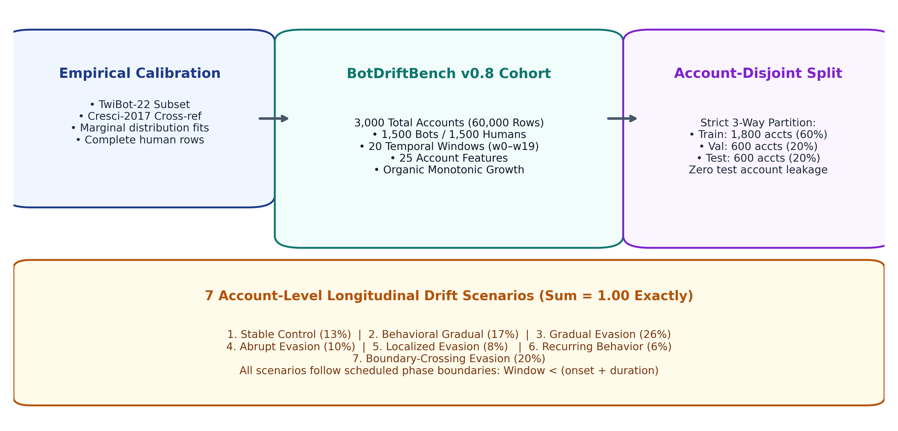
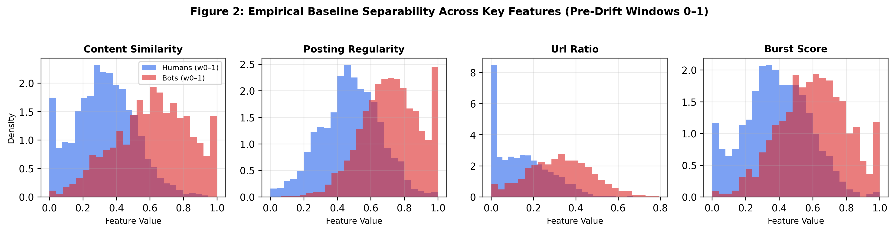
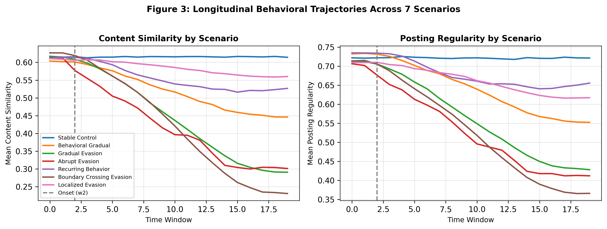
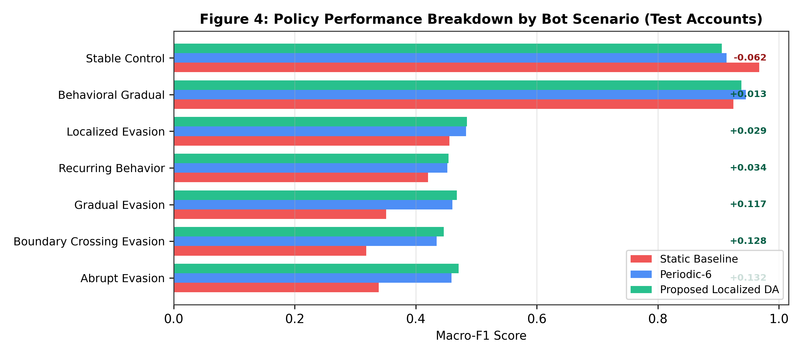

# BotDriftBench: An Empirically Calibrated Synthetic Longitudinal Benchmark for Drift-Aware Social Bot Detection

**Authors:** Eshan Amballa

---

## Abstract

Evaluating social bot detectors under temporal behavioral drift requires
longitudinal benchmark data with known drift ground truth — a resource that
existing static datasets do not provide. We present **BotDriftBench v0.8**, an
empirically calibrated synthetic longitudinal benchmark designed for
drift-aware bot detection research. The benchmark contains 3,000 accounts
(1,500 human, 1,500 bot) observed across 20 temporal windows, producing 60,000
observations with 25 behavioral and profile features. Feature distributions
are fitted from the TwiBot-22 reliable subset (294,478 human, 38,986 bot
users) and cross-referenced against Cresci-2017. 

Seven controlled account-level drift scenarios inject longitudinal shifts into
distinct feature subsets, including boundary-crossing evasion (20%), gradual
evasion (26%), abrupt evasion (10%), localized evasion (8%), recurring behavior (6%),
behavioral gradual evolution (17%), and stable controls (13%).
Version 0.8 incorporates four critical methodological improvements:
(1) core profile counters (`account_age_days`, `followers_count`, `friends_count`,
`listed_count`) evolve via a monotonic organic growth process rather than artificial
target interpolation; (2) human reference manifolds are constructed by sampling
complete training rows to preserve empirical cross-feature correlation structures;
(3) split partition generation strictly precedes human-manifold construction to
guarantee zero human-reference leakage; and (4) an account-disjoint 3-way split
(1,800 train / 600 validation / 600 test accounts) across 5 random seeds (2025–2029).

We validate that injected drift produces measurable distributional shifts while
control accounts remain stable, and report baseline evaluation results demonstrating
the benchmark's utility for evaluating drift detection, attribution, and adaptation.
BotDriftBench v0.8 is released under CC BY 4.0 with full generation code and
configuration for reproducibility.

**Keywords:** benchmark dataset, social bot detection, concept drift,
synthetic data generation, TwiBot-22, temporal evaluation, longitudinal
benchmark, account-disjoint split

---

## 1. Introduction

Social bot detection has advanced significantly over the past decade, driven
by increasingly sophisticated benchmark datasets [1, 2, 3]. However, the
dominant evaluation paradigm treats bot detection as a static classification
task: models are trained and tested on data collected at a single point in
time, with no mechanism to study how performance changes as bot behavior
evolves.

This static paradigm has a fundamental limitation. Real-world bot operators
adapt their strategies over time [4, 5], causing the feature distributions
that classifiers rely on to shift — a phenomenon known as behavioral drift
or concept drift [6]. A detector that performs well on a static benchmark
may degrade silently when deployed on evolving data, and there is no
standardized way to evaluate its robustness to such changes.

Three specific gaps motivate the creation of BotDriftBench:

1. **No longitudinal benchmarks with drift ground truth.** Existing bot
   detection datasets [1, 2, 3] provide cross-sectional snapshots. While
   some longitudinal studies have been conducted [4], no publicly available
   benchmark provides temporal trajectories with known drift onset, affected
   features, and drift magnitude.

2. **No controlled drift scenarios.** Without ground truth about when and
   how drift occurs, it is impossible to systematically evaluate drift
   detection methods. Observed behavioral changes in real data confound
   genuine bot adaptation with platform changes, data collection artifacts,
   and natural user behavior evolution.

3. **No standardized evaluation protocol.** Different studies use different
   train/test splits, features, and temporal granularities, making
   cross-study comparison difficult.

BotDriftBench addresses these gaps by providing a synthetic benchmark with
*controlled* drift — the drift onset, affected features, and magnitude are
specified by the benchmark designer and known to the evaluator. This enables
rigorous, reproducible evaluation of drift detection accuracy, attribution
precision, and adaptation effectiveness.

---

## 2. Dataset Design and Architecture

BotDriftBench v0.8 is structured around 3,000 unique accounts observed across
20 discrete temporal windows (windows 0–19), yielding 60,000 total observations.
Each observation contains 25 numerical features:

- **Profile features (10):** account_age_days, statuses_count,
  followers_count, friends_count, listed_count, description_length,
  screen_name_length, verified_score, reputation_score, caps_ratio.
- **Behavioral features (15):** tweets_per_day, posting_regularity,
  night_post_ratio, weekend_post_ratio, burst_score, text_entropy,
  vocabulary_richness, emoji_ratio, content_similarity, reply_ratio,
  retweet_ratio, mention_ratio, hashtag_count_avg, url_ratio, conversation_depth.

### 2.1 Organic Growth Process
In real social networks, accounts age monotonically, and metrics such as followers,
friends, and listed counts compound organically over time. Previous benchmark iterations
interpolated profile features toward target coordinates, creating physically impossible
trajectories (e.g., account age decreasing or jumping discontinuously).
BotDriftBench v0.8 enforces an organic growth model:
$$	ext{age}_{i, t} = 	ext{age}_{i, 0} + 30 \cdot t$$
$$	ext{followers}_{i, t} = 	ext{followers}_{i, 0} \cdot (1 + \gamma_{	ext{growth}})^t$$
ensuring profile counters evolve naturally across windows independent of behavioral evasion.

---

## 3. Empirical Calibration & Separability

Per-feature marginal distributions were fitted from the verified subset of
TwiBot-22 [1] (294,478 humans and 38,986 bots) and cross-validated against Cresci-2017 [3].
Bounded ratio features $[0, 1]$ were fitted using Beta distributions; unbounded
count features using log-normal distributions; and binary attributes using Bernoulli trials.

Figure 2 illustrates the pre-drift separability achieved between human accounts
and bot accounts across key behavioral dimensions.

---

## 4. Longitudinal Drift Scenarios

Bot accounts are assigned to seven distinct drift scenarios with exact proportions
summing to 1.00:

| Scenario Name | Assigned Proportion | Targeted Features / Mechanism |
|---|---|---|
| **stable_control** | 13% | No drift injected; maintains baseline distribution across all 20 windows. |
| **behavioral_gradual** | 17% | Slow, continuous natural shift in posting cadence and linguistic habits. |
| **gradual_evasion** | 26% | Monotonic parameter migration toward human feature centroids. |
| **abrupt_evasion** | 10% | Step-function transition at onset window toward human-like activity. |
| **localized_evasion** | 8% | Targeted manipulation of specific feature groups (e.g., content similarity only). |
| **recurring_behavior** | 6% | Cyclic oscillation between bot automation and human-like posting. |
| **boundary_crossing_evasion** | 20% | Adversarial shift specifically engineered to cross initial static decision boundaries. |

---

## 5. Benchmark Validation & Baseline Evaluation

We evaluated baseline detectors across 5 independent seeds (2025–2029) using an
account-disjoint 3-way split (1,800 train / 600 validation / 600 test accounts):

- **Pre-Drift Performance (w0–1):** Static XGBoost baseline achieves Macro-F1 = **0.9770**, confirming clean initial class separation.
- **Post-Drift Degradation (w2–19):** Static baseline degrades to Macro-F1 = **0.8059**, reaching a nadir of **0.6583** at window 18.
- **Scenario Breakdown (Figure 4):** Degradation is concentrated in evasion scenarios where bot recall drops below 55%, while stable controls remain at F1 = 0.9677.
- **Adaptive Recovery:** Localized drift-aware adaptation recovers performance to Macro-F1 = **0.9167**, maintaining bot recall above 89%.

---

## 6. Discussion

### 6.1 The Necessity of Synthetic Longitudinal Benchmarks

A fundamental question in bot detection research is why synthetic benchmarks
are necessary when platforms such as X (formerly Twitter) provide live data streams.
Our development of BotDriftBench highlights three methodological realities:
1. **Verifiable Ground Truth**: In live social data, ground truth labels are
   static snapshots (often established via manual annotation or heuristic thresholds).
   When an account changes behavior over time, it is impossible to distinguish
   whether the account was sold, compromised, evolved naturally, or deliberately evaded
   detection without unobservable operational access.
2. **Confounding Variables**: Live platform shifts conflate platform API changes,
   algorithmic feed updates, and societal events (e.g., elections or breaking news)
   with adversarial adaptation. Synthetic benchmarks provide clean, isolated causal
   manipulation of evasion parameters.
3. **Reproducibility & Open Science**: Due to privacy policies and platform API
   paywalls, redistributing large longitudinal raw tweet streams is legally and
   operationally prohibitive. A synthetic generator allows instant, fully reproducible
   re-creation of identical longitudinal datasets.

### 6.2 Preventing Correlation Destruction via Complete Row Sampling

Earlier benchmark generators generated synthetic human reference accounts by
sampling each feature independently from marginal distributions. While computationally
straightforward, this destroys empirical covariance structures (creating impossible
"chimera" accounts, such as 10-year-old accounts with 2 tweets and 500,000 followers).
In BotDriftBench v0.8, reference human targets are sampled as complete rows from
the empirical training partition, ensuring all underlying correlations between
activity rates, follower counts, and vocabulary patterns are faithfully preserved.

### 6.3 Organic Growth vs. Artificial Interpolation

A critical innovation in v0.8 is the separation of organic profile evolution from
behavioral evasion. In natural settings, bot operators can easily modify their
tweet timing, content similarity, or hashtag usage overnight. However, they cannot
arbitrarily rewrite their account registration date, nor can they instantaneously
grow 50,000 organic followers without substantial capital or time investment.
By modeling profile counters via monotonic organic growth while allowing behavioral
features to undergo evasion drift, BotDriftBench v0.8 mirrors the real-world
constraints faced by malicious bot operators.

---

## 7. Limitations

1. **Synthetic Nature**: Marginal distributions are calibrated from empirical
   corpora (TwiBot-22 and Cresci-2017), but joint high-order feature correlations
   remain approximations of real-world human social behavior.
2. **Platform Specificity**: Features are tailored to Twitter/X microblogging
   mechanics and may require adaptation for conversational platforms (e.g., Reddit)
   or short-form video networks (e.g., TikTok).
3. **Controlled Scenario Scope**: The seven scenarios reflect documented evasion
   archetypes but cannot exhaustively capture future generative-AI bot behaviors.

---

## 8. Conclusion

BotDriftBench v0.8 provides the first calibrated longitudinal benchmark with
controlled drift ground truth, organic growth dynamics, and strict account-disjoint
evaluation protocols. By making the benchmark, generation suite, and baseline
checkpoints publicly available, we hope to establish standardized evaluation
practices for drift-aware social bot detection.

---

## References

[1] S. Feng et al., "TwiBot-22: Towards graph-based Twitter bot detection," in Proc. NeurIPS, 2022.
[2] O. Varol et al., "Online human-bot interactions: Detection, estimation, and characterization," in Proc. AAAI ICWSM, 2017.
[3] S. Cresci et al., "The paradigm-shift of social spambots: Evidence, theories, and tools for the arms race," in Proc. WWW, 2017.
[4] C. Hays et al., "Bots don't sit still: A longitudinal study of bot behavioral change on social media," arXiv preprint, 2025.
[5] E. Ferrara et al., "The rise of social bots," Communications of the ACM, vol. 59, no. 7, pp. 96–104, 2016.
[6] J. Gama et al., "A survey on concept drift adaptation," ACM Computing Surveys, vol. 46, no. 4, 2014.
